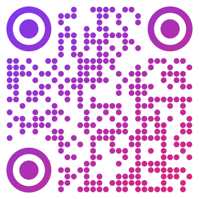
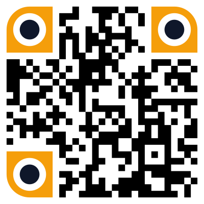
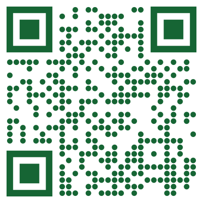

Simple QrCode
=============

**QR codes for Laravel, and for any PHP 8.2+ project.** Logos, colors, gradients, dots, rounded and pointy eyes, in `svg`, `png`, `webp` or `eps`, with ready-made codes for Wi-Fi, payments, e-mails and calendar events.

The maintained successor of [simplesoftwareio/simple-qrcode](https://github.com/SimpleSoftwareIO/simple-qrcode): same namespace, same facade, same API. Swap the package, keep your code.

[](https://packagist.org/packages/jamalofski/simple-qrcode)


[](LICENSE)

<table>
  <tr>
    <td align="center"><br><sub>Round modules, rounded eyes</sub></td>
    <td align="center"><br><sub>Your logo, on a cleared area</sub></td>
    <td align="center"><br><sub>Dots, gradient, round eyes</sub></td>
  </tr>
  <tr>
    <td align="center"><br><sub>Pointy eyes, in your colors</sub></td>
    <td align="center"><br><sub>Hex colors, background included</sub></td>
    <td align="center"><br><sub>Scan to join the Wi-Fi</sub></td>
  </tr>
</table>

<details>
<summary>The code behind them: one line each</summary>

```php
QrCode::style('round', 0.9)->eye('rounded')->colorFromHex('#1d4ed8');
QrCode::eye('rounded')->colorFromHex('#0f172a')->merge('/public/logo.png', .2)->clearUnderLogo(1);
QrCode::style('dot', 0.9)->externalEye('circle')->internalEye('circle')->gradientFromHex('#7c3aed', '#db2777', 'diagonal');
QrCode::eye('pointy')->eyeColorFromHex(0, '#f59e0b', '#0f172a'); // and the same for eyes 1 and 2
QrCode::style('round', 0.6)->externalEye('rounded')->internalEye('circle')->colorFromHex('#0e7490')->backgroundColorFromHex('#ecfeff');
QrCode::style('dot', 0.85)->eye('square')->colorFromHex('#166534')->wiFi(['encryption' => 'WPA', 'ssid' => 'Guest network', 'password' => 'welcome-2026']);
```

Each one with `size(400)->margin(1)`, in `svg`. Every code above scans.

</details>

## Why this fork

The original package has had no release since 4.2.0 (February 2021). It requires `bacon/bacon-qr-code` ^2, while `laravel/fortify` requires ^3: it can no longer be installed next to Fortify or the official Laravel starter kits. This fork fixes that, and keeps going.

- **Installs where the original cannot.** `bacon/bacon-qr-code` ^3, PHP 8.2 to 8.5, Laravel 11 to 13, each supported combination tested.
- **A drop-in replacement.** Same namespace (`SimpleSoftwareIO\QrCode`), same `QrCode` facade, same API. It declares `replace` for `simplesoftwareio/simple-qrcode`, so packages that depend on the original name keep working, and its version numbers continue from the original.
- **Fixes what stayed open for years.** Logos in `svg`, transparent backgrounds turning black under a logo, blurry small `png`, `png` without `imagick`, Wi-Fi passwords with special characters, `+` signs in e-mail codes.
- **Adds what users asked for.** Modules cleared under a logo, rounded and pointy eyes with the ring and the center styled apart, hex colors, `webp`, SEPA payment and calendar codes, your own module and eye shapes.

## Features

- **Formats**: `svg` and `eps` for the web and for print; `png` and `webp`, lossless by default, rendered with `imagick` or, without it, with GD.
- **Logos**: any image centered on the code, in `png`, `webp` and `svg`, over the modules or on a cleared area. The error correction rises to `H` by itself.
- **Design**: square, dot and round modules; square, circle, rounded and pointy eyes; RGB or hex colors with transparency; five gradients; your own module and eye shapes.
- **Helpers**: e-mail, phone number, SMS, geo location, Wi-Fi, Bitcoin, SEPA credit transfer (EPC, also known as GiroCode) and calendar events.
- **Anywhere**: the Laravel facade and Blade, or plain PHP, Symfony included.

## Installation

```bash
composer require jamalofski/simple-qrcode
```

Laravel discovers the service provider and the `QrCode` alias automatically.

`png` and `webp` images are rendered with `imagick` when it is installed, and with GD otherwise. GD draws square modules and square eyes only, without gradient: `style('dot')`, `style('round')`, eye styles other than `square` and `gradient()` need `imagick` in `png` and `webp`, and throw an exception without it. `webp` also needs GD with WebP support, even with `imagick`. `svg` and `eps` support every option.

## Quick start

```blade
{!! QrCode::size(200)->generate(Request::url()) !!}
```

```php
use SimpleSoftwareIO\QrCode\Facades\QrCode;

// A png with your logo, saved to a file
QrCode::format('png')->size(500)->merge('/path/to/logo.png', .2, true)->clearUnderLogo()
    ->generate('https://example.com', storage_path('app/qrcode.png'));

// A code guests scan to join your Wi-Fi
QrCode::wiFi(['encryption' => 'WPA', 'ssid' => 'Guest network', 'password' => 'welcome-2026']);

// A SEPA credit transfer that banking apps fill in
QrCode::EPC(['name' => 'Red Cross of Belgium', 'iban' => 'BE72 0000 0000 1616', 'amount' => 10]);

// An event that phones add to their calendar
QrCode::calendar(['summary' => 'Product launch', 'start' => '2026-12-01 18:00', 'timezone' => 'Europe/Paris']);
```

The full documentation is in [docs/en/README.md](docs/en/README.md). Without Laravel, see [Usage Outside of Laravel](docs/en/README.md#usage-outside-of-laravel).

## Migrating from simplesoftwareio/simple-qrcode

Swap the package in `composer.json`:

```bash
composer remove simplesoftwareio/simple-qrcode --no-update
composer require jamalofski/simple-qrcode
```

The two packages cannot be installed together: Composer treats the fork as the original.

Your code does not change, but a few behaviors do since 4.2. The [CHANGELOG](CHANGELOG.md) lists them first in each version.

- PHP 8.2 or later is required.
- `bacon/bacon-qr-code` ^3 replaces ^2. If you use BaconQrCode classes directly, check its [changelog](https://github.com/Bacon/BaconQrCode/blob/main/CHANGELOG.md).
- The SVG output keeps the same shapes; some path segments are written in a different order, which matters only if you compare raw SVG strings.
- With `imagick`, square modules and eyes are drawn without antialiasing in `png` and `webp`, so small images are sharp: the pixels change, which matters only if you compare images.
- A merged logo raises the error correction from `L` to `H` unless you set one, and `merge()` now applies to `svg` too.
- `wiFi()` escapes `\`, `;`, `,`, `"` and `:` itself: remove your own escaping if you had one.

## Translations

[Deutsch](docs/de/README.md) | [Español](docs/es/README.md) | [Français](docs/fr/README.md) | [Italiano](docs/it/README.md) | [Português](docs/pt-br/README.md) | [Русский](docs/ru/README.md) | [日本語](docs/ja/README.md) | [한국어](docs/kr/README.md) | [हिंदी](docs/hi/README.md) | [简体中文](docs/zh-cn/README.md) | [العربية](docs/ar/README.md)

The translations predate version 4 and some sections are out of date. The English documentation is the reference.

## Contributing

Issues and pull requests are welcome on [jamalofski/simple-qrcode](https://github.com/jamalofski/simple-qrcode).

## Credits

Simple QrCode was created by Simple Software LLC and its contributors. This fork keeps their history and their MIT license.

## License

MIT. See [LICENSE](LICENSE).
