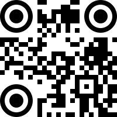

#### [Deutsch](../de/README.md) | [Español](../es/README.md) | [Français](../fr/README.md) | [Italiano](../it/README.md) | [Português](../pt-br/README.md) | [Русский](../ru/README.md) | [日本語](../ja/README.md) | [한국어](../kr/README.md) | [हिंदी](../hi/README.md) | [简体中文](../zh-cn/README.md)

<a id="docs-introduction"></a>
## Introduction
Simple QrCode is an easy to use wrapper for the popular Laravel framework based on the great work provided by [Bacon/BaconQrCode](https://github.com/Bacon/BaconQrCode).  We created an interface that is familiar and easy to install for Laravel users.

 

<a id="docs-upgrade"></a>
## Upgrade Guide

Coming from `simplesoftwareio/simple-qrcode`: replace it with `jamalofski/simple-qrcode` in your `composer.json`. Version 4.3 requires PHP 8.2 and `bacon/bacon-qr-code` ^3; your code does not change.

Upgrade from v2 or v3 by changing your `composer.json` file to `^4.3`

`png` and `webp` images are rendered with `imagick` when it is installed, and with GD otherwise. GD draws square modules and square eyes only, without gradient: `style('dot')`, `style('round')`, eye styles other than `square` and `gradient()` need `imagick` in `png` and `webp`, and throw an exception without it. `svg` and `eps` support every option.

#### v4

> There was a mistake when creating 4.1.0 and allowing a backwards breaking change into the master branch.  The `generate` method will now return an instance of `Illuminate\Support\HtmlString` if you are running Laravel.  See https://github.com/SimpleSoftwareIO/simple-qrcode/issues/205 for more information.

There was a Laravel facade issue within v3 that causes some loading issues.  The only way to fix this was to create a backwards breaking change so v4 has been released.  If you are coming from v2 there is no need to change any code.  The below change only effects users on v3.

All references to the `QrCode` facade need to be changed to:

```
use SimpleSoftwareIO\QrCode\Facades\QrCode;
```

<a id="docs-configuration"></a>
## Configuration

#### Composer

Run `composer require jamalofski/simple-qrcode "^4.3"` to add the package. 

Laravel will automatically pick up and install the package.

<a id="docs-ideas"></a>
## Simple Ideas

#### Print View

One of the main items that we use this package for is to have QrCodes in all of our print views.  This allows our customers to return to the original page after it is printed by simply scanning the code.  We achieved this by adding the following into our footer.blade.php file:

	<div class="visible-print text-center">
		{!! QrCode::size(100)->generate(Request::url()); !!}
		<p>Scan me to return to the original page.</p>
	</div>

#### Embed A QrCode

You may embed a qrcode inside of an e-mail to allow your users to quickly scan.  The following is an example of how to do this with Laravel:

	//Inside of a blade template.
	embedData(QrCode::format('png')->generate('Embed me into an e-mail!'), 'QrCode.png', 'image/png')!!}">

<a id="docs-usage"></a>
## Usage

#### Basic Usage

```
// All examples below assume you are pulling in the QrCode facade with the following line of code. The Facade is auto-loaded for Laravel users.

use SimpleSoftwareIO\QrCode\Facades\QrCode;
```

Using the QrCode Generator is very easy.  The most basic syntax is:

	use SimpleSoftwareIO\QrCode\Facades\QrCode;

	QrCode::generate('Make me into a QrCode!');

This will make a QrCode that says "Make me into a QrCode!"


#### Generate `(string $data, string $filename = null)`

`Generate` is used to make the QrCode.

	QrCode::generate('Make me into a QrCode!');

`Generate` by default will return a SVG image string.  You can print this directly into a modern browser within Laravel's Blade system with the following:

	{!! QrCode::generate('Make me into a QrCode!'); !!}

The `generate` method has a second parameter that will accept a filename and path to save the QrCode.

	QrCode::generate('Make me into a QrCode!', '../public/qrcodes/qrcode.svg');

#### Format `(string $format)`

Four formats are supported: `png`, `webp`, `eps` and `svg`. To change the format use the following code:

	QrCode::format('png');  //Will return a png image
	QrCode::format('webp'); //Will return a webp image
	QrCode::format('eps');  //Will return a eps image
	QrCode::format('svg');  //Will return a svg image

> Without `imagick`, `png` and `webp` are rendered with GD: square modules and square eyes only, without gradient.

A `webp` image is lossless by default, and usually smaller than the same `png`. It needs GD with WebP support, which most PHP builds have. `quality` makes it lossy, from 0 to 100; QrCodes compress so well without loss that a lossy `webp` is often larger.

	QrCode::format('webp')->generate('Make me into a QrCode!'); // Lossless
	QrCode::format('webp')->quality(80)->generate('Make me into a QrCode!'); // Lossy

A `png` image is always lossless. `compression` sets its zlib level, from 0 (no compression, fastest) to 9 (smallest file, the default): it changes the size of the file and the time to write it, never the image.

	QrCode::format('png')->compression(1)->generate('Make me into a QrCode!');

#### Size `(int $size)`

You can change the size of a QrCode by using the `size` method. Simply specify the size desired in pixels using the following syntax:

	QrCode::size(100);

  

#### Color `(int $red, int $green, int $blue, int $alpha = null)`

>Be careful when changing the color of a QrCode, as some readers have a very difficult time reading QrCodes in color.

All colors must be expressed in RGBA (Red Green Blue Alpha).  You can change the color of a QrCode by using the following:

	QrCode::color(255, 0, 0); // Red QrCode
	QrCode::color(255, 0, 0, 25); //Red QrCode with 25% transparency 

 

#### Background Color `(int $red, int $green, int $blue, int $alpha = null)`

You can change the background color of a QrCode by calling the `backgroundColor` method.

	QrCode::backgroundColor(255, 0, 0); // Red background QrCode
	QrCode::backgroundColor(255, 0, 0, 25); //Red background QrCode with 25% transparency 

 

#### Hex Colors

Every color method has a twin that takes hex colors: `#rgb`, `#rgba`, `#rrggbb` or `#rrggbbaa`, with or without the `#`. The alpha digits go from `00`, transparent, to `ff`, opaque.

	QrCode::colorFromHex('#1d4ed8');
	QrCode::backgroundColorFromHex('#ffffff00'); // Transparent background
	QrCode::eyeColorFromHex(0, '#e11d48', '#0f172a'); // Same order as eyeColor()
	QrCode::gradientFromHex('#1d4ed8', '#7c3aed', 'diagonal');

#### Gradient `$startRed, $startGreen, $startBlue, $endRed, $endGreen, $endBlue, string $type)`

You can apply a gradient to the QrCode by calling the `gradient` method.

The following gradient types are supported:

| Type | Example |
| --- | --- |
| `vertical` |  |
| `horizontal` |  |
| `diagonal` |  |
| `inverse_diagonal` |  |
| `radial` |  |

In `png`, gradients fail with `non-conforming drawing primitive definition 'push'` on ImageMagick 7.1.2-19 to 7.1.2-21 and 6.9.13-44 to 6.9.13-46, and on distribution packages that took the CVE-2026-33901 fix without its follow-up. Update ImageMagick: 7.1.2-22 and 6.9.13-47 fixed it.

#### EyeColor `(int $eyeNumber, int $innerRed, int $innerGreen, int $innerBlue, int $outterRed = 0, int $outterGreen = 0, int $outterBlue = 0)`

You may change the eye colors by using the `eyeColor` method.

	QrCode::eyeColor(0, 255, 255, 255, 0, 0, 0); // Changes the eye color of eye `0`

| Eye Number | Example |
| --- | --- |
| `0` |  |
| `1` | |
| `2` |  |


#### Style `(string $style, float $size = 0.5)`

The style can be easily swapped out with `square`, `dot,` or `round`.  This will change the blocks within the QrCode.  The second parameter will affect the size of the dots or roundness.

	QrCode::style('dot'); // Uses the `dot` style.

Unless you choose an eye style, the `dot` style draws the eyes with dots too, and some readers, ZXing among them, cannot find eyes made of dots: the QrCode may not scan. Set `square` or `circle` eyes with it, as in the example below.

	QrCode::style('dot')->eye('square');

| Style | Example |
| --- | --- |
| `square` |  |
| `dot` | |
| `round` |  |

#### Eye Style `(string $style)`

The eye within the QrCode supports four styles: `square`, `circle`, `rounded` and `pointy`.

	QrCode::eye('circle'); // Uses the `circle` style eye.

| Style | Example |
| --- | --- |
| `square` |  |
| `circle` | |
| `rounded` | |
| `pointy` | |

`eye('circle')` rounds the center of the eye and keeps its square ring, as it always did.

#### External and Internal Eye `(string $style)`

`externalEye` styles the ring of the eyes and `internalEye` their center, over the style set with `eye`. They take the same four styles. With `externalEye('circle')`, the ring is round.

	QrCode::externalEye('circle')->internalEye('circle'); // Round ring, round center
	QrCode::eye('rounded')->internalEye('square'); // Rounded ring, square center

| Example | Result |
| --- | --- |
| `externalEye('circle')->internalEye('circle')` | |

#### Margin `(int $margin)`

The ability to change the margin around a QrCode is also supported.  Simply specify the desired margin using the following syntax:

	QrCode::margin(100);

#### Error Correction `(string $errorCorrection)`

Changing the level of error correction is easy.  Just use the following syntax:

	QrCode::errorCorrection('H');

The following are supported options for the `errorCorrection` method:

| Error Correction | Assurance Provided |
| --- | --- |
| L | 7% of codewords can be restored. |
| M | 15% of codewords can be restored. |
| Q | 25% of codewords can be restored. |
| H | 30% of codewords can be restored. |

>The more error correction used; the bigger the QrCode becomes and the less data it can store. Read more about [error correction](http://en.wikipedia.org/wiki/QR_code#Error_correction).

#### Encoding `(string $encoding)`

Change the character encoding that is used to build a QrCode.  By default `ISO-8859-1` is selected as the encoder.  Read more about [character encoding](http://en.wikipedia.org/wiki/Character_encoding).

You can change this to any of the following:

	QrCode::encoding('UTF-8')->generate('Make me a QrCode with special symbols ♠♥!!');

| Character Encoder |
| --- |
| ISO-8859-1 |
| ISO-8859-2 |
| ISO-8859-3 |
| ISO-8859-4 |
| ISO-8859-5 |
| ISO-8859-6 |
| ISO-8859-7 |
| ISO-8859-8 |
| ISO-8859-9 |
| ISO-8859-10 |
| ISO-8859-11 |
| ISO-8859-12 |
| ISO-8859-13 |
| ISO-8859-14 |
| ISO-8859-15 |
| ISO-8859-16 |
| SHIFT-JIS |
| WINDOWS-1250 |
| WINDOWS-1251 |
| WINDOWS-1252 |
| WINDOWS-1256 |
| UTF-16BE |
| UTF-8 |
| ASCII |
| GBK |
| EUC-KR |

#### Merge `(string $filepath, float $percentage = .2, bool $absolute = false)`

The `merge` method merges an image over a QrCode.  This is commonly used to placed logos within a QrCode.

	//Generates a QrCode with an image centered in the middle.
	QrCode::format('png')->merge('path-to-image.png')->generate();
	
	//Generates a QrCode with an image centered in the middle.  The inserted image takes up 30% of the QrCode.
	QrCode::format('png')->merge('path-to-image.png', .3)->generate();
	
	//Generates a QrCode with an image centered in the middle.  The inserted image takes up 30% of the QrCode.
	QrCode::format('png')->merge('http://www.google.com/someimage.png', .3, true)->generate();

>The `merge` method works with the `png`, `webp` and `svg` formats; `eps` ignores it.
>The filepath is relative to app base path if `$absolute` is set to `false`.  Change this variable to `true` to use absolute paths.

>In `svg`, the image is embedded in the QrCode as a data URI. It can be a png, jpeg, gif, webp or svg image. Browsers show an svg logo; a few converters, such as old versions of librsvg, leave it out: use a png logo for them.

	QrCode::errorCorrection('H')->merge('path-to-logo.svg', .25)->generate(); // svg QrCode with an svg logo

>You should use a high level of error correction when using the `merge` method to ensure that the QrCode is still readable.  We recommend using `errorCorrection('H')`.


#### Merge Binary String `(string $content, float $percentage = .2)`

The `mergeString` method can be used to achieve the same as the `merge` call, except it allows you to provide a string representation of the file instead of the filepath. This is usefull when working with the `Storage` facade. It's interface is quite similar to the `merge` call. 

	//Generates a QrCode with an image centered in the middle.
	QrCode::format('png')->mergeString(Storage::get('path/to/image.png'))->generate();
	
	//Generates a QrCode with an image centered in the middle.  The inserted image takes up 30% of the QrCode.
	QrCode::format('png')->mergeString(Storage::get('path/to/image.png'), .3)->generate();

>As with the normal `merge` call, it works with `png`, `webp` and `svg`. The same applies for error correction, high levels are recommened.

#### Advance Usage

All methods support chaining.  The `generate` method must be called last.  For example you could run any of the following:

	QrCode::size(250)->color(150,90,10)->backgroundColor(10,14,244)->generate('Make me a QrCode!');
	QrCode::format('png')->size(399)->color(40,40,40)->generate('Make me a QrCode!');

You can display a PNG image without saving the file by providing a raw string and encoding with `base64_encode`.

	size(100)->generate('Make me into an QrCode!')) !!} ">

<a id="docs-helpers"></a>
## Helpers

#### What are helpers?

Helpers are an easy way to create QrCodes that cause a reader to perform a certain action when scanned.  

#### BitCoin

This helper generates a scannable bitcoin to send payments.  [More information](https://bitco.in/en/developer-guide#plain-text)

	QrCode::BTC($address, $amount);
	
	//Sends a 0.334BTC payment to the address
	QrCode::BTC('bitcoin address', 0.334);
	
	//Sends a 0.334BTC payment to the address with some optional arguments
	QrCode::size(500)->BTC('address', 0.0034, [
        'label' => 'my label',
        'message' => 'my message',
        'returnAddress' => 'https://www.returnaddress.com'
    ]);

#### SEPA Credit Transfer (EPC)

This helper makes the EPC QR code of a SEPA credit transfer, also known as GiroCode: banking apps read it to fill in the transfer. It follows the EPC069-12 guidelines, version 002.

	QrCode::EPC([
		'name' => 'Red Cross of Belgium',  // Beneficiary, required, 70 characters at most
		'iban' => 'BE72 0000 0000 1616',   // Required; spaces are removed and the checksum is checked
		'bic' => 'BPOTBEB1',               // Optional within the EEA
		'amount' => 10.50,                 // Optional, in euros, from 0.01 to 999999999.99
		'purpose' => 'CHAR',               // Optional purpose code, four letters
		'text' => 'Donation',              // Optional remittance text, 140 characters at most
	]);

Instead of `text`, `reference` takes a structured creditor reference (RF...), 35 characters at most; an EPC QR code holds one or the other. `information` adds a note for the payer, 70 characters at most.

The QrCode uses error correction `M`, as the guidelines require, unless you set another with `errorCorrection`. Its character set follows the encoding of the QrCode: ISO-8859-1 by default, which covers the names of Western Europe. For other names, use `encoding('UTF-8')`. An invalid transfer throws an `InvalidArgumentException`.

#### E-Mail

This helper generates an e-mail qrcode that is able to fill in the e-mail address, subject, and body:

	QrCode::email($to, $subject, $body);
	
	//Fills in the to address
	QrCode::email('foo@bar.com');
	
	//Fills in the to address, subject, and body of an e-mail.
	QrCode::email('foo@bar.com', 'This is the subject.', 'This is the message body.');
	
	//Fills in just the subject and body of an e-mail.
	QrCode::email(null, 'This is the subject.', 'This is the message body.');
	
#### Geo

This helper generates a latitude and longitude that a phone can read and opens the location in Google Maps or similar app.

	QrCode::geo($latitude, $longitude);
	
	QrCode::geo(37.822214, -122.481769);
	
#### Phone Number

This helper generates a QrCode that can be scanned and then dials a number.

	QrCode::phoneNumber($phoneNumber);
	
	QrCode::phoneNumber('555-555-5555');
	QrCode::phoneNumber('1-800-Laravel');
	
#### SMS (Text Messages)

This helper makes SMS messages that can be prefilled with the send to address and body of the message:

	QrCode::SMS($phoneNumber, $message);
	
	//Creates a text message with the number filled in.
	QrCode::SMS('555-555-5555');
	
	//Creates a text message with the number and message filled in.
	QrCode::SMS('555-555-5555', 'Body of the message');

#### WiFi

This helpers makes scannable QrCodes that can connect a phone to a WiFi network. Pass the SSID and the password as they are: `\`, `;`, `,`, `"` and `:` are escaped for you.

	QrCode::wiFi([
		'encryption' => 'WPA/WEP',
		'ssid' => 'SSID of the network',
		'password' => 'Password of the network',
		'hidden' => 'Whether the network is a hidden SSID or not.'
	]);
	
	//Connects to an open WiFi network.
	QrCode::wiFi([
		'ssid' => 'Network Name',
	]);
	
	//Connects to an open, hidden WiFi network.
	QrCode::wiFi([
		'ssid' => 'Network Name',
		'hidden' => 'true'
	]);
	
	//Connects to a secured WiFi network.
	QrCode::wiFi([
		'ssid' => 'Network Name',
		'encryption' => 'WPA',
		'password' => 'myPassword'
	]);
	
>WiFi scanning is not currently supported on Apple Products.

<a id="docs-common-usage"></a>
## Common QrCode Usage

You can use a prefix found in the table below inside the `generate` section to create a QrCode to store more advanced information:

	QrCode::generate('http://www.example.com');


| Usage | Prefix | Example |
| --- | --- | --- |
| Website URL | http:// | http://www.example.com |
| Secured URL | https:// | https://www.example.com |
| E-mail Address | mailto: | mailto:support@example.com |
| Phone Number | tel: | tel:555-555-5555 |
| Text (SMS) | sms: | sms:555-555-5555 |
| Text (SMS) With Pretyped Message | sms: | sms::I am a pretyped message |
| Text (SMS) With Pretyped Message and Number | sms: | sms:555-555-5555:I am a pretyped message |
| Geo Address | geo: | geo:-78.400364,-85.916993 |
| MeCard | mecard: | MECARD:Simple, Software;Some Address, Somewhere, 20430;TEL:555-555-5555;EMAIL:support@example.com; |
| VCard | BEGIN:VCARD | [See Examples](https://en.wikipedia.org/wiki/VCard) |
| Wifi | wifi: | wifi:WEP/WPA;SSID;PSK;Hidden(True/False) |

<a id="docs-outside-laravel"></a>
## Usage Outside of Laravel

You may use this package outside of Laravel by instantiating a new `Generator` class.

	use SimpleSoftwareIO\QrCode\Generator;

	$qrcode = new Generator;
	$qrcode->size(500)->generate('Make a qrcode without Laravel!');
