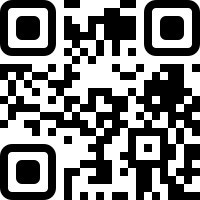
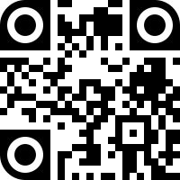
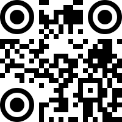

#### [English](../en/README.md) | [Deutsch](../de/README.md) | [Español](../es/README.md) | [Italiano](../it/README.md) | [Português](../pt-br/README.md) | [Русский](../ru/README.md) | [日本語](../ja/README.md) | [한국어](../kr/README.md) | [हिंदी](../hi/README.md) | [简体中文](../zh-cn/README.md) | [العربية](../ar/README.md)

<a id="docs-introduction"></a>
## Introduction
Simple QrCode est une surcouche simple d'emploi pour Laravel, bâtie sur l'excellent travail de [Bacon/BaconQrCode](https://github.com/Bacon/BaconQrCode). Elle offre une interface familière aux utilisateurs de Laravel et facile à installer. Elle fonctionne aussi sans Laravel.

 

<a id="docs-upgrade"></a>
## Mise à jour

Depuis `simplesoftwareio/simple-qrcode` : remplacez-le par `jamalofski/simple-qrcode` dans votre `composer.json`. La version 4.3 demande PHP 8.2 et `bacon/bacon-qr-code` ^3. Votre code ne change pas, mais quelques comportements changent : le [CHANGELOG](../../CHANGELOG.md) les liste en premier dans chaque version.

Depuis la v2 ou la v3, passez la contrainte de votre `composer.json` à `^4.3`.

Les images `png` et `webp` sont produites avec `imagick` s'il est installé, et avec GD sinon. GD ne dessine que des modules carrés et des yeux carrés, sans dégradé : `style('dot')`, `style('round')`, les styles d'yeux autres que `square` et `gradient()` demandent `imagick` en `png` et en `webp`, et lèvent une exception sans lui. Le `webp` demande aussi GD avec la prise en charge du WebP, même avec `imagick`. Le `svg` et l'`eps` acceptent toutes les options.

#### v4

> Une erreur s'est glissée dans la 4.1.0 et a laissé passer un changement incompatible : avec Laravel, la méthode `generate` renvoie désormais une instance de `Illuminate\Support\HtmlString`. Voir https://github.com/SimpleSoftwareIO/simple-qrcode/issues/205 pour en savoir plus.

La v3 avait un problème de façade Laravel qui gênait le chargement. Le seul moyen de le corriger était un changement incompatible, d'où la v4. Si vous venez de la v2, vous n'avez rien à changer dans votre code. Le changement ci-dessous ne concerne que les utilisateurs de la v3.

Toutes les références à la façade `QrCode` doivent devenir :

```
use SimpleSoftwareIO\QrCode\Facades\QrCode;
```

<a id="docs-configuration"></a>
## Configuration

#### Composer

Lancez `composer require jamalofski/simple-qrcode "^4.3"` pour ajouter le paquet.

Laravel le détecte et l'installe automatiquement.

<a id="docs-ideas"></a>
## Idées simples

#### Vue d'impression

Nous nous servons surtout de ce paquet pour mettre un QrCode sur toutes nos vues d'impression. Une fois la page imprimée, nos clients retrouvent la page d'origine en scannant simplement le code. Il suffit d'ajouter ceci à notre fichier footer.blade.php :

	<div class="visible-print text-center">
		{!! QrCode::size(100)->generate(Request::url()); !!}
		<p>Scannez-moi pour revenir à la page d'origine.</p>
	</div>

#### Insérer un QrCode dans un e-mail

Vous pouvez insérer un QrCode dans un e-mail pour que vos utilisateurs le scannent rapidement. Voici comment faire avec Laravel :

	//Dans un template Blade.
	embedData((string) QrCode::format('png')->generate('Embed me into an e-mail!'), 'QrCode.png', 'image/png')!!}">

Avec Laravel, `generate` renvoie un `Illuminate\Support\HtmlString`, et `embedData` n'accepte qu'une chaîne : convertissez-le avec `(string)`, comme ci-dessus.

<a id="docs-usage"></a>
## Utilisation

#### Utilisation de base

```
// Tous les exemples ci-dessous supposent que vous importez la façade QrCode avec la ligne suivante. Avec Laravel, la façade est chargée automatiquement.

use SimpleSoftwareIO\QrCode\Facades\QrCode;
```

Le générateur est très simple à utiliser. La syntaxe la plus simple est :

	use SimpleSoftwareIO\QrCode\Facades\QrCode;

	QrCode::generate('Make me into a QrCode!');

Ce code crée un QrCode qui contient « Make me into a QrCode! ».


#### Generate `(string $data, string $filename = null)`

`generate` crée le QrCode.

	QrCode::generate('Make me into a QrCode!');

Par défaut, `generate` renvoie une image SVG sous forme de chaîne. Dans une vue Blade, vous pouvez l'afficher directement dans un navigateur récent :

	{!! QrCode::generate('Make me into a QrCode!'); !!}

`generate` accepte en second paramètre un chemin de fichier où enregistrer le QrCode.

	QrCode::generate('Make me into a QrCode!', '../public/qrcodes/qrcode.svg');

#### Format `(string $format)`

Quatre formats sont pris en charge : `png`, `webp`, `eps` et `svg`. Pour changer de format :

	QrCode::format('png');  //Renvoie une image png
	QrCode::format('webp'); //Renvoie une image webp
	QrCode::format('eps');  //Renvoie une image eps
	QrCode::format('svg');  //Renvoie une image svg

> Sans `imagick`, le `png` et le `webp` sont produits avec GD : modules et yeux carrés uniquement, sans dégradé.

Les modules carrés et les yeux carrés sont dessinés sans anticrénelage, pour que les petites images restent nettes. Les autres styles le gardent avec `imagick`. Il faut pour cela `bacon/bacon-qr-code` 3.1 ou plus récent.

Une image `webp` est sans perte par défaut, et généralement plus légère que le même `png`. Elle demande GD avec la prise en charge du WebP, ce que la plupart des installations de PHP ont. `quality` la rend avec perte, de 0 à 100 ; les QrCodes se compressent si bien sans perte qu'un `webp` avec perte est souvent plus lourd.

	QrCode::format('webp')->generate('Make me into a QrCode!'); // Sans perte
	QrCode::format('webp')->quality(80)->generate('Make me into a QrCode!'); // Avec perte

Une image `png` est toujours sans perte. `compression` règle son niveau zlib, de 0 (le plus rapide, le fichier le plus lourd) à 9 (le fichier le plus léger), logo fusionné compris : il change la taille du fichier et le temps de l'écrire, jamais l'image.

	QrCode::format('png')->compression(1)->generate('Make me into a QrCode!');

#### Taille `(int $size)`

La méthode `size` change la taille d'un QrCode. Indiquez simplement la taille voulue en pixels :

	QrCode::size(100);

 

Un QrCode `svg` a un `viewBox`, donc le CSS peut le redimensionner : avec `width: 100%; height: auto`, il suit la largeur de son conteneur.

#### Couleur `(int $red, int $green, int $blue, int $alpha = null)`

> Attention en changeant la couleur d'un QrCode : certains lecteurs ont beaucoup de mal à lire les QrCodes en couleur.

Toutes les couleurs s'expriment en RGBA (rouge, vert, bleu, alpha). Pour changer la couleur d'un QrCode :

	QrCode::color(255, 0, 0); // QrCode rouge
	QrCode::color(255, 0, 0, 25); // QrCode rouge transparent à 25 %

 

#### Couleur de fond `(int $red, int $green, int $blue, int $alpha = null)`

La méthode `backgroundColor` change la couleur de fond d'un QrCode.

	QrCode::backgroundColor(255, 0, 0); // QrCode sur fond rouge
	QrCode::backgroundColor(255, 0, 0, 25); // QrCode sur fond rouge transparent à 25 %

 

#### Couleurs hexadécimales

Chaque méthode de couleur a une jumelle qui prend des couleurs hexadécimales : `#rgb`, `#rgba`, `#rrggbb` ou `#rrggbbaa`, avec ou sans le `#`. Les chiffres de l'alpha vont de `00`, transparent, à `ff`, opaque.

	QrCode::colorFromHex('#1d4ed8');
	QrCode::backgroundColorFromHex('#ffffff00'); // Fond transparent
	QrCode::eyeColorFromHex(0, '#e11d48', '#0f172a'); // Même ordre qu'eyeColor()
	QrCode::gradientFromHex('#1d4ed8', '#7c3aed', 'diagonal');

#### Dégradé `$startRed, $startGreen, $startBlue, $endRed, $endGreen, $endBlue, string $type)`

La méthode `gradient` applique un dégradé au QrCode.

Les types de dégradé suivants sont pris en charge :

| Type | Exemple |
| --- | --- |
| `vertical` |  |
| `horizontal` |  |
| `diagonal` |  |
| `inverse_diagonal` |  |
| `radial` |  |

En `png`, les dégradés échouent avec `non-conforming drawing primitive definition 'push'` sur ImageMagick 7.1.2-19 à 7.1.2-21 et 6.9.13-44 à 6.9.13-46, ainsi que sur les paquets de distribution qui ont repris le correctif de la CVE-2026-33901 sans sa suite. Mettez ImageMagick à jour : les versions 7.1.2-22 et 6.9.13-47 ont corrigé le problème.

#### Couleur des yeux `(int $eyeNumber, int $innerRed, int $innerGreen, int $innerBlue, int $outterRed = 0, int $outterGreen = 0, int $outterBlue = 0)`

La méthode `eyeColor` change la couleur des yeux.

	QrCode::eyeColor(0, 255, 255, 255, 0, 0, 0); // Change la couleur de l'œil 0

| Numéro de l'œil | Exemple |
| --- | --- |
| `0` |  |
| `1` | |
| `2` |  |


#### Style `(string $style, float $size = 0.5)`

Le style se change facilement en `square`, `dot` ou `round`. Il modifie les modules du QrCode. Le second paramètre règle la taille des points ou l'arrondi : plus de 0, jusqu'à 1.

	QrCode::style('dot'); // Utilise le style `dot`.

Sauf si vous choisissez un style d'yeux, le style `dot` dessine aussi les yeux avec des points, et certains lecteurs, dont ZXing, ne trouvent pas des yeux faits de points : le QrCode risque de ne pas être lu. Associez-lui des yeux `square` ou `circle`, comme dans l'exemple ci-dessous.

	QrCode::style('dot')->eye('square');

| Style | Exemple |
| --- | --- |
| `square` |  |
| `dot` | |
| `round` |  |

#### Style des yeux `(string $style)`

Les yeux du QrCode acceptent quatre styles : `square`, `circle`, `rounded` et `pointy`.

	QrCode::eye('circle'); // Utilise le style d'yeux `circle`.

| Style | Exemple |
| --- | --- |
| `square` |  |
| `circle` | |
| `rounded` | |
| `pointy` | |

`eye('circle')` arrondit le centre de l'œil et garde son anneau carré, comme il l'a toujours fait.

#### Anneau et centre des yeux `(string $style)`

`externalEye` règle le style de l'anneau des yeux et `internalEye` celui de leur centre, par-dessus le style choisi avec `eye`. Ils prennent les mêmes quatre styles. Avec `externalEye('circle')`, l'anneau est rond.

	QrCode::externalEye('circle')->internalEye('circle'); // Anneau rond, centre rond
	QrCode::eye('rounded')->internalEye('square'); // Anneau arrondi, centre carré

| Exemple | Résultat |
| --- | --- |
| `externalEye('circle')->internalEye('circle')` | |

#### Style et yeux personnalisés `(ModuleInterface $module)`, `(EyeInterface $eye)`

`customStyle` dessine les modules avec votre propre module, et `customEye` les yeux avec votre propre œil, à la place de `style` et `eye`. Un module implémente `BaconQrCode\Renderer\Module\ModuleInterface` et un œil `BaconQrCode\Renderer\Eye\EyeInterface`, de [bacon/bacon-qr-code](https://github.com/Bacon/BaconQrCode/tree/main/src/Renderer). Entre `style` et `customStyle`, et entre `eye` et `customEye`, le dernier appelé l'emporte ; `externalEye` et `internalEye` s'appliquent toujours par-dessus un œil personnalisé.

	use BaconQrCode\Renderer\Eye\SimpleCircleEye;
	use BaconQrCode\Renderer\Module\DotsModule;

	QrCode::customStyle(new DotsModule(0.8))->customEye(SimpleCircleEye::instance());
	QrCode::customEye(new MyEye); // Votre classe qui implémente EyeInterface

> Les modules et les yeux personnalisés demandent `imagick` en `png` et en `webp` ; le `svg` et l'`eps` les dessinent tels quels.

#### Marge `(int $margin)`

Vous pouvez aussi changer la marge autour d'un QrCode. Indiquez simplement la marge voulue :

	QrCode::margin(100);

#### Correction d'erreur `(string $errorCorrection)`

Changer le niveau de correction d'erreur est simple :

	QrCode::errorCorrection('H');

La méthode `errorCorrection` accepte les niveaux suivants :

| Correction d'erreur | Garantie |
| --- | --- |
| L | 7 % des mots de code peuvent être restaurés. |
| M | 15 % des mots de code peuvent être restaurés. |
| Q | 25 % des mots de code peuvent être restaurés. |
| H | 30 % des mots de code peuvent être restaurés. |

> Plus la correction d'erreur est élevée, plus le QrCode est grand et moins il peut contenir de données. En savoir plus sur la [correction d'erreur](https://fr.wikipedia.org/wiki/Code_QR).

#### Encodage `(string $encoding)`

Change l'encodage des caractères utilisé pour construire un QrCode. Par défaut, l'encodage est `ISO-8859-1`. En savoir plus sur le [codage des caractères](https://fr.wikipedia.org/wiki/Codage_des_caract%C3%A8res).

Vous pouvez choisir l'un des encodages suivants :

	QrCode::encoding('UTF-8')->generate('Make me a QrCode with special symbols ♠♥!!');

| Encodage des caractères |
| --- |
| ISO-8859-1 |
| ISO-8859-2 |
| ISO-8859-3 |
| ISO-8859-4 |
| ISO-8859-5 |
| ISO-8859-6 |
| ISO-8859-7 |
| ISO-8859-8 |
| ISO-8859-9 |
| ISO-8859-10 |
| ISO-8859-11 |
| ISO-8859-12 |
| ISO-8859-13 |
| ISO-8859-14 |
| ISO-8859-15 |
| ISO-8859-16 |
| SHIFT-JIS |
| WINDOWS-1250 |
| WINDOWS-1251 |
| WINDOWS-1252 |
| WINDOWS-1256 |
| UTF-16BE |
| UTF-8 |
| ASCII |
| GBK |
| EUC-KR |

#### Fusionner une image `(string $filepath, float $percentage = .2, bool $absolute = false)`

La méthode `merge` fusionne une image par-dessus un QrCode. On s'en sert généralement pour placer un logo dans un QrCode.

	//Génère un QrCode avec une image au centre.
	QrCode::format('png')->merge('path-to-image.png')->generate();

	//Génère un QrCode avec une image au centre. L'image occupe 30 % du QrCode.
	QrCode::format('png')->merge('path-to-image.png', .3)->generate();

	//Génère un QrCode avec une image au centre. L'image occupe 30 % du QrCode.
	QrCode::format('png')->merge('http://www.google.com/someimage.png', .3, true)->generate();

> La méthode `merge` fonctionne avec les formats `png`, `webp` et `svg` ; l'`eps` l'ignore.
> Si `$absolute` vaut `false`, le chemin est relatif au dossier de base de l'application, avec ou sans barre oblique au début : `public/logo.png` et `/public/logo.png` désignent le même fichier. Passez cette variable à `true` pour utiliser des chemins absolus.

> En `svg`, l'image est intégrée au QrCode sous forme d'URI data. Ce peut être n'importe quelle image matricielle reconnue par PHP (png, jpeg, gif, webp...) ou une image svg. Les navigateurs affichent un logo svg ; quelques convertisseurs, comme les anciennes versions de librsvg, l'omettent : utilisez alors un logo png.

	QrCode::errorCorrection('H')->merge('path-to-logo.svg', .25)->generate(); // QrCode svg avec un logo svg

> Un logo masque une partie du QrCode : au niveau de correction par défaut, `L`, la plupart des codes ne se lisent plus derrière. Sauf si vous fixez un niveau avec `errorCorrection`, la méthode `merge` le monte à `H`, le plus élevé.


#### Vider la zone sous le logo `(int $margin = 0)`

Par défaut, l'image recouvre les modules placés dessous. `clearUnderLogo` les retire à la place : l'image repose sur le fond, sur une zone découpée suivant les modules, avec `$margin` modules de plus autour. Les yeux et les informations de format restent toujours.

	QrCode::format('png')->merge('path-to-image.png', .2)->clearUnderLogo()->generate('Make me into a QrCode!');
	QrCode::format('png')->merge('path-to-image.png', .2)->clearUnderLogo(1)->generate('Make me into a QrCode!'); // Un module autour de l'image

> La zone vidée correspond à l'image arrondie au module entier supérieur, plus la marge : elle est donc plus grande que l'image. Sur un contenu court, où les modules sont grands, gardez l'image à 20 % et la marge à 0 : une zone plus grande risque de ne plus être lue.

#### Fusionner une image sous forme de chaîne `(string $content, float $percentage = .2)`

La méthode `mergeString` fait la même chose que `merge`, mais prend le contenu du fichier au lieu de son chemin. C'est pratique avec la façade `Storage`. Son interface ressemble beaucoup à celle de `merge`.

	//Génère un QrCode avec une image au centre.
	QrCode::format('png')->mergeString(Storage::get('path/to/image.png'))->generate();

	//Génère un QrCode avec une image au centre. L'image occupe 30 % du QrCode.
	QrCode::format('png')->mergeString(Storage::get('path/to/image.png'), .3)->generate();

> Comme `merge`, elle fonctionne en `png`, en `webp` et en `svg`, et monte la correction d'erreur à `H` sauf si vous en fixez une.

#### Utilisation avancée

Toutes les méthodes s'enchaînent. La méthode `generate` doit être appelée en dernier. Par exemple :

	QrCode::size(250)->color(150,90,10)->backgroundColor(10,14,244)->generate('Make me a QrCode!');
	QrCode::format('png')->size(399)->color(40,40,40)->generate('Make me a QrCode!');

Vous pouvez afficher une image PNG sans l'enregistrer en encodant la chaîne brute avec `base64_encode`.

	size(100)->generate('Make me into an QrCode!')) !!} ">

<a id="docs-helpers"></a>
## Helpers

#### Qu'est-ce qu'un helper ?

Les helpers créent facilement des QrCodes qui déclenchent une action précise une fois scannés.

#### Bitcoin

Ce helper génère un QrCode de paiement en bitcoin. [En savoir plus](https://bitco.in/en/developer-guide#plain-text)

	QrCode::BTC($address, $amount);

	//Envoie un paiement de 0,334 BTC à l'adresse
	QrCode::BTC('bitcoin address', 0.334);

	//Envoie un paiement de 0,0034 BTC à l'adresse, avec des options
	QrCode::size(500)->BTC('address', 0.0034, [
        'label' => 'my label',
        'message' => 'my message',
        'returnAddress' => 'https://www.returnaddress.com'
    ]);

#### Événement d'agenda

Ce helper crée un événement d'agenda (un `VEVENT` iCalendar) que le téléphone propose d'ajouter à son agenda.

	QrCode::encoding('UTF-8')->calendar([
		'summary' => 'Lancement du produit',      // Obligatoire
		'start' => '2026-12-01 18:00',            // Obligatoire : une date en chaîne ou un DateTimeInterface
		'end' => '2026-12-01 20:00',              // Facultatif
		'timezone' => 'Europe/Paris',             // Facultatif : le fuseau horaire des dates en chaîne
		'location' => 'Paris',                    // Facultatif
		'description' => 'Ouverture à 17 h 30.',  // Facultatif
		'url' => 'https://example.com/launch',    // Facultatif
	]);

	// Un événement sur la journée entière, du 1er au 3 décembre inclus
	QrCode::encoding('UTF-8')->calendar(['summary' => 'Conférence', 'start' => '2026-12-01', 'end' => '2026-12-03', 'allDay' => true]);

Les heures sont écrites en UTC. Une date en chaîne est lue dans le fuseau `timezone`, ou dans le fuseau par défaut de PHP sans lui ; un `DateTimeInterface` garde le sien. Un événement sur la journée entière ne prend que des dates, et son `end` est son dernier jour. Pour un texte avec des accents, utilisez `encoding('UTF-8')`. Un événement invalide, ou un champ inconnu, lève une `InvalidArgumentException`.

#### Virement SEPA (EPC)

Ce helper crée le QR code EPC d'un virement SEPA, aussi appelé GiroCode : les applications bancaires le lisent pour remplir le virement. Il suit les recommandations EPC069-12, version 002.

	QrCode::EPC([
		'name' => 'Red Cross of Belgium',  // Bénéficiaire, obligatoire, 70 caractères au plus
		'iban' => 'BE72 0000 0000 1616',   // Obligatoire ; les espaces sont retirés et la clé est vérifiée
		'bic' => 'BPOTBEB1',               // Facultatif dans l'EEE, obligatoire pour un IBAN hors de l'EEE
		'amount' => 10.50,                 // Facultatif, en euros, de 0,01 à 999 999 999,99
		'purpose' => 'CHAR',               // Facultatif, code de motif en quatre lettres
		'text' => 'Donation',              // Facultatif, libellé du virement, 140 caractères au plus
	]);

À la place de `text`, `reference` prend une référence structurée du créancier (RF...), 35 caractères au plus ; un QR code EPC contient l'un ou l'autre. `information` ajoute une note pour le payeur, 70 caractères au plus.

Le QrCode utilise la correction d'erreur `M`, comme l'exigent les recommandations, sauf si vous en fixez une autre avec `errorCorrection`. Son jeu de caractères suit l'encodage du QrCode : ISO-8859-1 par défaut, qui couvre les noms d'Europe de l'Ouest. Pour les autres noms, utilisez `encoding('UTF-8')`. Un virement invalide lève une `InvalidArgumentException`.

#### E-mail

Ce helper génère un QrCode d'e-mail qui remplit l'adresse, l'objet et le corps du message :

	QrCode::email($to, $subject, $body);

	//Remplit l'adresse du destinataire
	QrCode::email('foo@bar.com');

	//Remplit l'adresse, l'objet et le corps d'un e-mail.
	QrCode::email('foo@bar.com', 'This is the subject.', 'This is the message body.');

	//Remplit seulement l'objet et le corps d'un e-mail.
	QrCode::email(null, 'This is the subject.', 'This is the message body.');

#### Géolocalisation

Ce helper génère une latitude et une longitude que le téléphone lit pour ouvrir le lieu dans Google Maps ou une application semblable.

	QrCode::geo($latitude, $longitude);

	QrCode::geo(37.822214, -122.481769);

#### Numéro de téléphone

Ce helper génère un QrCode qui, une fois scanné, compose un numéro.

	QrCode::phoneNumber($phoneNumber);

	QrCode::phoneNumber('555-555-5555');
	QrCode::phoneNumber('1-800-Laravel');

#### SMS (messages texte)

Ce helper crée des SMS pré-remplis avec le numéro du destinataire et le texte du message :

	QrCode::SMS($phoneNumber, $message);

	//Crée un SMS avec le numéro rempli.
	QrCode::SMS('555-555-5555');

	//Crée un SMS avec le numéro et le message remplis.
	QrCode::SMS('555-555-5555', 'Body of the message');

#### Wi-Fi

Ce helper crée des QrCodes qui connectent un téléphone à un réseau Wi-Fi. Passez le SSID et le mot de passe tels quels : `\`, `;`, `,`, `"` et `:` sont échappés pour vous.

	QrCode::wiFi([
		'encryption' => 'WPA/WEP',
		'ssid' => 'SSID of the network',
		'password' => 'Password of the network',
		'hidden' => 'Whether the network is a hidden SSID or not.'
	]);

	//Se connecte à un réseau Wi-Fi ouvert.
	QrCode::wiFi([
		'ssid' => 'Network Name',
	]);

	//Se connecte à un réseau Wi-Fi ouvert et masqué.
	QrCode::wiFi([
		'ssid' => 'Network Name',
		'hidden' => 'true'
	]);

	//Se connecte à un réseau Wi-Fi sécurisé.
	QrCode::wiFi([
		'ssid' => 'Network Name',
		'encryption' => 'WPA',
		'password' => 'myPassword'
	]);

> L'appareil photo de l'iPhone lit les QrCodes Wi-Fi depuis iOS 11, comme celui de la plupart des téléphones Android récents.

<a id="docs-common-usage"></a>
## Usages courants des QrCodes

Vous pouvez placer dans `generate` un préfixe du tableau ci-dessous pour stocker des informations plus élaborées dans un QrCode :

	QrCode::generate('http://www.example.com');


| Usage | Préfixe | Exemple |
| --- | --- | --- |
| Adresse de site web | http:// | http://www.example.com |
| Adresse sécurisée | https:// | https://www.example.com |
| Adresse e-mail | mailto: | mailto:support@example.com |
| Numéro de téléphone | tel: | tel:555-555-5555 |
| SMS | sms: | sms:555-555-5555 |
| SMS avec message pré-rempli | sms: | sms::I am a pretyped message |
| SMS avec message pré-rempli et numéro | sms: | sms:555-555-5555:I am a pretyped message |
| Coordonnées géographiques | geo: | geo:-78.400364,-85.916993 |
| Événement d'agenda | BEGIN:VEVENT | Voir le helper calendar plus haut |
| MeCard | mecard: | MECARD:Simple, Software;Some Address, Somewhere, 20430;TEL:555-555-5555;EMAIL:support@example.com; |
| VCard | BEGIN:VCARD | [Voir les exemples](https://fr.wikipedia.org/wiki/VCard) |
| Wi-Fi | wifi: | wifi:WEP/WPA;SSID;PSK;Hidden(True/False) |

<a id="docs-outside-laravel"></a>
## Utilisation sans Laravel

Vous pouvez utiliser ce paquet sans Laravel en instanciant une nouvelle classe `Generator`. Elle n'a besoin d'aucun paquet Laravel : `generate` renvoie alors une simple chaîne.

	use SimpleSoftwareIO\QrCode\Generator;

	$qrcode = new Generator;
	$qrcode->size(500)->generate('Make a qrcode without Laravel!');

Un `Generator` garde ses réglages d'un QrCode à l'autre : créez-en un nouveau pour chaque QrCode. La façade Laravel le fait pour vous.

#### Symfony

Déclarez le `Generator` comme un service non partagé, pour que chaque injection en reçoive un nouveau. Un service partagé garderait le format, les couleurs et le logo du QrCode précédent, au sein d'une requête et, avec un runtime de type worker comme FrankenPHP, d'une requête à l'autre.

	# config/services.yaml
	services:
	    SimpleSoftwareIO\QrCode\Generator:
	        shared: false

Injectez-le ensuite, par exemple dans un contrôleur :

	use SimpleSoftwareIO\QrCode\Generator;
	use Symfony\Component\HttpFoundation\Response;
	use Symfony\Component\Routing\Attribute\Route;

	#[Route('/qrcode.svg')]
	public function qrCode(Generator $qrCode): Response
	{
	    return new Response($qrCode->size(200)->generate('https://example.com'), 200, ['Content-Type' => 'image/svg+xml']);
	}

Dans Twig, affichez un QrCode `svg` avec le filtre `raw`. Pour un `png`, encodez-le avec `base64_encode` avant de le passer au template, et utilisez-le dans une URI `data:image/png;base64,`.
